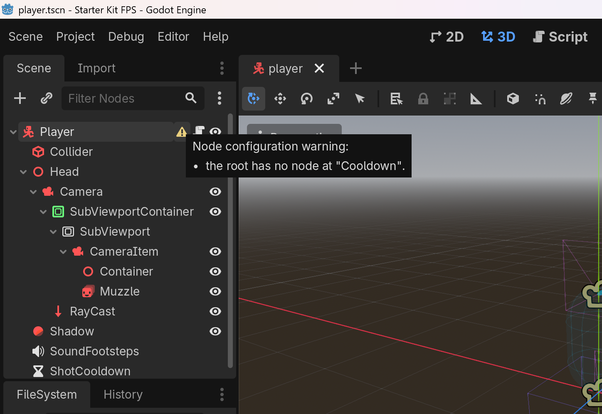

# Petrichor

Petrichor is a statically typed scripting language for Godot 4 that keeps GDScript's syntax. Code written as in GDScript either behaves the same or fails at compile time with a suggested fix. It ships as a GDExtension for the official editor. Exports use the official templates, with no custom engine build.

0.1 has been released. Semantics may still change before 1.0; see [Status and Limitations](#status-and-limitations).

中文：[README.zh.md](README.zh.md)



## Why

As Godot projects grow, refactoring depends more and more on errors that only show at run time. GDScript's typing is gradual. Even in fully typed GDScript, node paths, signal connections and exported properties stay dynamic in scenes. Object references are nullable by default, and runtime errors still hand callers a fallback value. C# brings static types, but its bridge has many pitfalls ([survey](docs/surveys/pitfalls.md)).

Petrichor extends static checking into scenes, and makes null values and failures visible at compile time.

## Compared with GDScript

This GDScript passes the checks but fails at run time. It does so when `Camera` is renamed in the scene, or when `target` is null:

```gdscript
@onready var camera: Camera3D = $Head/Camera
var target: Node3D

func aim():
    camera.look_at(target.global_position)
```

In Petrichor, the scene the script is attached to gives `camera` its type. Renaming the node fails at compile time. `target` becomes `Node3D?`, which must be checked before use:

```gdscript
@onready var camera = $Head/Camera
var target: Node3D?

func aim():
    camera.look_at(target.global_position)
    # error: The value may be None (Node3D?); check it before reading "global_position".
```

```gdscript
func aim():
    var t := target
    if t != None:
        camera.look_at(t.global_position)
```

Other differences:

- Signal connections and exported properties are checked against scenes too, with errors marked on scene nodes.
- Object types are non-null by default. A freed object reads as `None` through `T?`.
- Expected failures use `Option` and `Result[T, E]`, with a postfix `?` for early return.
- Value-type `struct`, `enum` with payloads, exhaustive `match`, interfaces and nested typed containers.
- `async func` returns an owned `Task`. When its owner is freed, the coroutine is cancelled. Whoever awaits it gets a cancellation or a program error instead of hanging forever.
- It mixes with GDScript plugins and C# code.
- The editor has completion, hover types, go to definition, formatting, breakpoints and hot reload of function bodies.

The full rules are in the [language specification](docs/language-spec.md).

In microbenchmarks, computation runs 1.2 to 3.5 times as fast as GDScript, and engine property access about 1.6 times. Calls to engine methods, signals and object creation spend their time in the engine, so the two are close. Project startup takes the same time ([benchmarks](docs/architecture.md#4-性能)).

The migrated scripts of two real projects run: Kenney's FPS starter kit and the breakout minigame in Ring ([migration survey](docs/surveys/paper-migration-2.md)).

## Trying It

It needs the official Godot 4.7 editor, standard or .NET. The [Releases](https://github.com/YYF233333/Petrichor/releases) page offers two packages:

- The demo, `petrichor-<version>-demo.zip`: the FPS starter kit with migrated scripts. Unpack it and open it in the editor. It runs once the import ends.
- The extension, `petrichor-<version>-addon.zip`: unpack it into the project's root, which gives `addons/petrichor/`. Restart the editor to create `.pet` scripts.

To upgrade, close the editor and replace `addons/petrichor/` with the new one. Then run the project once from the editor, which compiles every script again.

On macOS the libraries are signed ad hoc and not notarized. A package downloaded with a browser is quarantined, and the system refuses to load its libraries. After unpacking, run this in the project's directory:

```sh
xattr -dr com.apple.quarantine addons/petrichor
```

CI tests each release with the official editor and the official export templates. It edits, runs and exports a project, as a debug and a release build.

| Platform | Library | Tested on |
|---|---|---|
| Windows | x86_64 | Windows Server 2022 |
| Linux | x86_64, needs glibc 2.35 or later | Ubuntu 22.04 |
| macOS | universal (x86_64 and arm64), needs macOS 11 or later | macOS 15 on arm64; x86_64 through Rosetta |

To check a whole project in CI:

```sh
godot --headless --path <project> --import
godot --headless -e --path <project> -- --petrichor-build
godot --headless -e --path <project> -- --petrichor-format --check
```

Only a fresh clone needs the first line, and its exit code need not be checked. The editor of Godot 4.7 can crash when it exits right after it first opens a project ([godot#111048](https://github.com/godotengine/godot/issues/111048)).

To build from source, you need a C++17 toolchain and SCons. Run `git submodule update --init`, then `scons`.

## Status and Limitations

0.1 is the first public release. It gathers feedback on the semantics from real projects before 1.0.

- Suited to: projects that already use typed GDScript heavily and accept code changes during 0.x.
- Not yet suited to: projects that export to Android, iOS or Web. Their libraries come with 0.9.
- Before 0.9, the language semantics may change, and release notes list every incompatible change. From 0.9, a change in what code means shows as a compile error. Fixes that change only runtime behavior are listed apart in release notes.
- Bytecode is not compatible across builds. After upgrading the extension, rebuild the project once.
- The editor lacks find references, rename, quick fixes, lints and LSP. They are planned for 0.2–0.3.
- There is no GDScript migration tool yet, so 0.1 needs manual migration. The tool is planned for 0.2–0.3 and works both ways. A file that uses no feature GDScript lacks converts back to GDScript, even after this project stops. A file that uses one, such as a struct or `Result`, is not converted; the tool lists where.
- Godot 4.7 and later are supported.

The full roadmap is in the [architecture](docs/architecture.md#5-推进顺序), and unfinished work in [BACKLOG.md](BACKLOG.md).

## How It Is Built

The author decides the language design and every rule of the specification. AI coding agents write most of the implementation, tests, documentation and corpus surveys. The author does not review the code line by line. The agents follow [AGENTS.md](AGENTS.md) in this repository. Correctness rests on these:

- The specification is the only source of rules. Where the implementation disagrees with it, the implementation changes.
- Tests are derived from the specification and the engine's behavior, not from the implementation.
- Each engine behavior relied on cites the Godot source, with commit and line.
- The migrated scripts of two real projects run in the engine.

The author is responsible for fixing what goes wrong. During 0.1, the project takes issues but not pull requests. Development moves fast, so a pull request is usually stale by the time it is reviewed. Report defects as issues and opinions on the language rules in Discussions; both get a reply within 48 hours. Pull requests open as 1.0 approaches.

## Documentation

- [Language specification](docs/language-spec.md)
- [Architecture](docs/architecture.md)
- [Design notes](docs/design-notes.md): the trade-offs behind the rules, corpus counts and rejected alternatives
- [Engine facts](docs/engine-facts.md): the engine behavior relied on, with source citations
- [Development notes](docs/development.md): pitfalls in building, testing and debugging
- [Corpus surveys](docs/surveys/README.md): across 20 Godot 4 projects, each with scripts to reproduce it

Documents under `docs/` are in Chinese. The language specification is also [in English](docs/language-spec.md), generated from the Chinese one, which prevails where they differ.

## License

[MIT](LICENSE)
