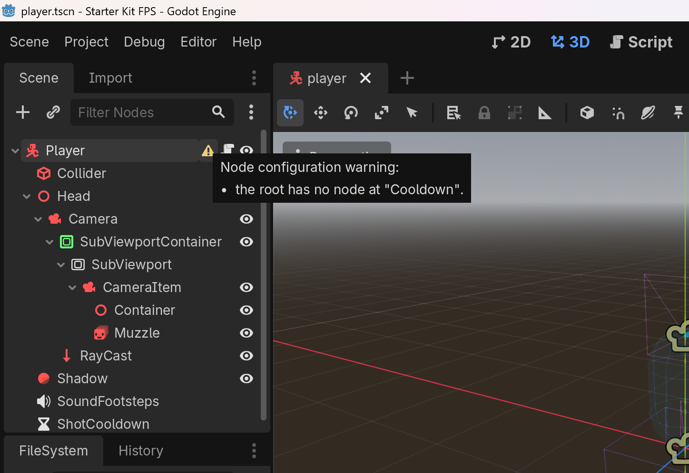

# Petrichor

Petrichor is a statically typed scripting language for Godot 4 that keeps GDScript's syntax. Apart from a few differences that the spec names, code written as in GDScript either behaves the same or fails at compile time with a suggested fix. It ships as a GDExtension for the official editor. Exports use the official templates, with no custom engine build.

0.2.1 has been released. Semantics may still change before 1.0; see [Status and Limitations](#status-and-limitations).

中文：[README.zh.md](README.zh.md)



## Why

As Godot projects grow, refactoring depends more and more on errors that only show at run time. GDScript's typing is gradual. Even in fully typed GDScript, node paths, signal connections and exported properties stay dynamic in scenes. Object references are nullable by default, and runtime errors still hand callers a fallback value. C# brings static types, but its bridge has many pitfalls ([survey](https://github.com/YYF233333/petrichor-corpus/blob/main/surveys/pitfalls.md)).

Petrichor extends static checking into scenes, and makes null values and failures visible at compile time.

## Compared with GDScript

This GDScript passes the checks but fails at run time. It does so when `Camera` is renamed in the scene, or when `target` is null:

```gdscript
@onready var camera: Camera3D = $Head/Camera
var target: Node3D

func aim():
    camera.look_at(target.global_position)
```

In Petrichor, the scene the script is attached to gives `camera` its type. Renaming the node in the scene dock updates the path. A path that matches no node fails at compile time. `target` becomes `Node3D?`, which must be checked before use:

```gdscript
@onready var camera = $Head/Camera
var target: Node3D?

func aim():
    camera.look_at(target.global_position)
    # error: The value may be None (Node3D?); check it before reading "global_position".
```

```gdscript
func aim():
    var t := target
    if t != None:
        camera.look_at(t.global_position)
```

Other differences:

- Signal connections and exported properties are checked against scenes too, with errors marked on scene nodes.
- Object types are non-null by default. A freed object reads as `None` through `T?`.
- Expected failures use `Option` and `Result[T, E]`, with a postfix `?` for early return.
- Value-type `struct`, `enum` with payloads, exhaustive `match`, interfaces and nested typed containers.
- `async func` returns an owned `Task`. When its owner is freed, the coroutine is cancelled. Whoever awaits it gets a cancellation or a program error instead of hanging forever.
- It mixes with GDScript plugins and C# code.
- The editor has completion, hover types, go to definition, find references, rename, quick fixes, formatting, breakpoints and hot reload of function bodies. Renaming or moving a node in the scene dock updates the paths to it in scripts.

The full rules are in the [language specification](docs/language-spec.md).

In microbenchmarks, computation runs 1.2 to 3.5 times as fast as GDScript, and engine property access about 1.6 times. Calls to engine methods, signals and object creation spend their time in the engine, so the two are close. Project startup takes the same time ([benchmarks](docs/architecture.md#4-性能)).

The migrated scripts of two real projects run: Kenney's FPS starter kit and the breakout minigame in Ring ([migration survey](https://github.com/YYF233333/petrichor-corpus/blob/main/surveys/paper-migration-2.md)).

## Trying It

It needs the official Godot 4.7 editor, standard or .NET. The [Releases](https://github.com/YYF233333/Petrichor/releases) page offers two packages:

- The demo, `petrichor-<version>-demo.zip`: the FPS starter kit with migrated scripts. Unpack it and open it in the editor. It runs once the import ends.
- The extension, `petrichor-<version>-addon.zip`: unpack it into the project's root, which gives `addons/petrichor/`. Restart the editor to create `.pet` scripts.

To upgrade, close the editor and replace `addons/petrichor/` with the new one. Then run the project once from the editor, which compiles every script again.

On macOS the libraries are signed ad hoc and not notarized. A package downloaded with a browser is quarantined, and the system refuses to load its libraries. After unpacking, run this in the project's directory:

```sh
xattr -dr com.apple.quarantine addons/petrichor
```

To edit scripts in VS Code, also install `petrichor-<version>.vsix` from the same page, with Extensions: Install from VSIX…. Open the project's folder in VS Code while the Godot editor has the project open. VS Code connects to that editor and gets its diagnostics and tools, except breakpoints. Saving a script in VS Code hot reloads it in a running game, as saving in Godot does. After undoing a rename in VS Code, save the files it changed: VS Code saves them after a rename, but not after undoing it. The checks read scenes and classes through the engine, so without a running Godot editor only highlighting works. While a script is in front, the status bar shows whether VS Code is connected. While Godot is in the background, it sleeps 100 ms a frame, so completion and other requests can wait that long. To shorten the wait, lower the editor setting Interface → Editor → Timers → Unfocused Low Processor Mode Sleep (µsec), at the cost of more power use.

CI tests each release with the official editor and the official export templates. It edits, runs and exports a project, as a debug and a release build.

| Platform | Library | Tested on |
|---|---|---|
| Windows | x86_64 | Windows Server 2022 |
| Linux | x86_64, needs glibc 2.35 or later | Ubuntu 22.04 |
| macOS | universal (x86_64 and arm64), needs macOS 11 or later | macOS 15 on arm64; x86_64 through Rosetta |

From the project's root, the command-line tool `pet` checks, builds and formats the whole project:

```sh
addons/petrichor/pet check            # checks the files on disk, writing no bytecode
addons/petrichor/pet build            # checks them and writes the bytecode
addons/petrichor/pet format --check   # lists the scripts not formatted; without --check, formats them
addons/petrichor/pet lsp              # bridges LSP clients such as Neovim and Helix over stdio
```

On Windows, write `addons\petrichor\pet`. While the Godot editor has the project open, the command runs in it, without another process. Otherwise `pet` runs a headless Godot, the one the editor recorded when it last opened the project. Where none was recorded, name one with `--godot <path>`, as in CI:

```sh
addons/petrichor/pet build --godot <godot>
addons/petrichor/pet format --check --godot <godot>
```

Each error takes one line, such as `player.pet:12:5: error: ...`. The exit code is 0 for no errors, 1 for errors or scripts not formatted, and 2 when it could not run. An agent that has written files runs `pet check` to get the result for the disk as it is now.

To build from source, you need a C++17 toolchain and SCons. Run `git submodule update --init`, then `scons`.

## Status and Limitations

0.1 is the first public release. It gathers feedback on the semantics before 1.0.

- Suited to: projects that already use typed GDScript heavily and accept code changes during 0.x.
- Not yet suited to: projects that export to Android, iOS or Web. Their libraries come from 0.4, first for the platforms where they are shown to work.
- Before 0.9, the language semantics may change, and release notes list every incompatible change. From 0.9, a change in what code means shows as a compile error. Fixes that change only runtime behavior are listed apart in release notes.
- A few constructs behave differently from GDScript without a compile error, where the design needs it. The [spec](docs/language-spec.md#12-relation-to-gdscript) names each one, and they stay open for comment until 0.9.
- Bytecode is not compatible across builds, so an upgrade compiles every script again.
- The editor lacks lints. They are planned for 0.3.
- There is no GDScript migration tool yet. Manual migration takes over twenty changes per hundred lines, so a real project is best tried with the tool, planned for 0.3. It works both ways. A file that uses no feature GDScript lacks converts back to GDScript, even after this project stops. A file that uses one, such as a struct or `Result`, is not converted; the tool lists where.
- Godot 4.7 and later are supported.

The full roadmap is in the [architecture](docs/architecture.md#5-推进顺序), and unfinished work in [BACKLOG.md](BACKLOG.md).

## How It Is Built

The author decides the language design and every rule of the specification. AI coding agents write most of the implementation, tests, documentation and corpus surveys. The author does not review the code line by line. The agents follow [AGENTS.md](AGENTS.md) in this repository. Correctness rests on these:

- The specification is the only source of rules. Where the implementation disagrees with it, the implementation changes.
- Tests are derived from the specification and the engine's behavior, not from the implementation.
- Each engine behavior relied on cites the Godot source, with commit and line.
- The migrated scripts of two real projects run in the engine.

The author is responsible for fixing what goes wrong. During 0.1, the project takes issues but not pull requests. Development moves fast, so a pull request is usually stale by the time it is reviewed. Report defects as issues and opinions on the language rules in Discussions; both get a reply within 48 hours. Pull requests open as 1.0 approaches.

## Documentation

- [Language specification](docs/language-spec.md)
- [Architecture](docs/architecture.md)
- [Design notes](docs/design-notes.md): the trade-offs behind the rules, corpus counts and rejected alternatives
- [Engine facts](docs/engine-facts.md): the engine behavior relied on, with source citations
- [Development notes](docs/development.md): pitfalls in building, testing and debugging
- [Corpus surveys](https://github.com/YYF233333/petrichor-corpus): across corpus v1's 20 Godot 4 projects and v2's 200, each with scripts to reproduce it, and an index from each rule to its evidence

Documents under `docs/` are in Chinese. The language specification is also [in English](docs/language-spec.md), generated from the Chinese one, which prevails where they differ.

## License

[MIT](LICENSE)
