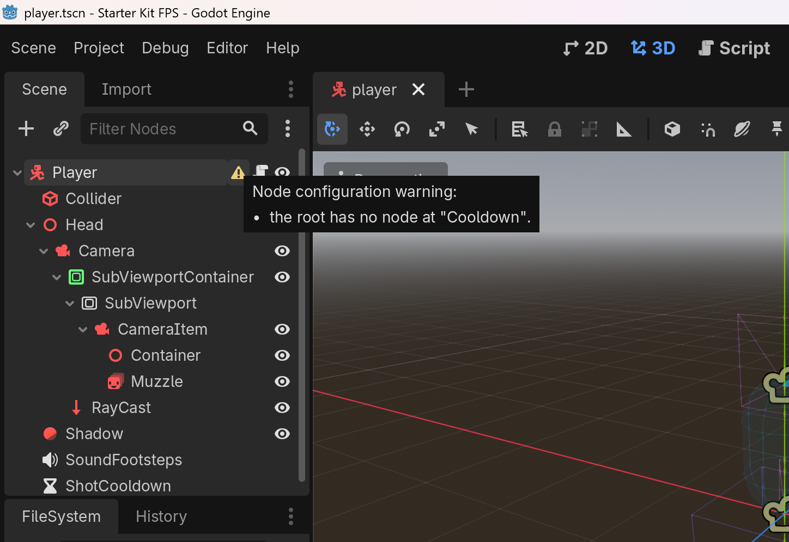

# Petrichor

Petrichor 是一门面向 Godot 4 的静态类型脚本语言，沿用 GDScript 的写法。它以标准 GDExtension 交付，装进官方编辑器即可使用，导出也复用官方模板，无需自编译引擎。除语言规范明确列出的几处差异外，按 GDScript 习惯写出的代码要么行为一致，要么在编译期报错并给出修改建议。

当前版本：**0.2.1**。1.0 之前语义仍可能调整，详见[状态与限制](#状态与限制)。

English: [README.md](README.md)



## 为什么

Godot 项目变大之后，重构越来越依赖运行游戏后才冒出来的报错。GDScript 采用渐进类型，即便脚本写满类型注解，场景里的节点路径、信号连接和导出属性依然是动态的。同时，对象引用默认可为空，运行时出错后调用方往往还会拿到一个兜底值继续执行。C# 虽然有静态类型，但跨引擎桥接层暗坑不少（[调查](https://github.com/YYF233333/petrichor-corpus/blob/main/surveys/pitfalls.md)）。

Petrichor 把静态检查延伸进场景，可空类型和可预期的失败都写在类型签名里，由编译器在使用处检查。

## 和 GDScript 的区别

下面这段 GDScript 能通过静态检查，但如果场景里的 `Camera` 改了名，或者 `target` 为 `null`，运行时就会报错：

```gdscript
@onready var camera: Camera3D = $Head/Camera
var target: Node3D

func aim():
    camera.look_at(target.global_position)
```

在 Petrichor 里，`camera` 会自动从挂载的场景推导出类型：在场景面板重命名节点时路径会同步更新，路径对不上任何节点则会直接报编译错误。`target` 声明为可空的 `Node3D?`，不经检查直接访问同样无法通过编译：

```gdscript
@onready var camera = $Head/Camera
var target: Node3D?

func aim():
    camera.look_at(target.global_position)
    # 编译错误：The value may be None (Node3D?); check it before reading "global_position".
```

先判空收窄类型，调用就能通过编译：

```gdscript
func aim():
    var t := target
    if t != None:
        camera.look_at(t.global_position)
```

其余主要差异：

- 信号连接和导出属性同样按场景做静态检查，报错直接标在对应的场景节点上。
- 对象类型默认非空，已释放的对象通过 `T?` 读取时会变成 `None`。
- 预期内的失败用 `Option` 和 `Result[T, E]` 表达，配合后缀 `?` 提前返回。
- 提供值语义的 `struct`、带载荷的 `enum`、穷尽检查的 `match`、接口以及嵌套带类型容器。
- `async func` 返回有归属的 `Task`：所属对象被释放后协程会自动取消，await 它的地方会收到取消或触发程序错误，不会无限挂起。
- 支持与项目里的 GDScript 插件和 C# 代码直接混用。
- 编辑器支持补全、悬停类型、跳转定义、查找引用、重命名、快速修复、格式化、断点和函数体热重载。在场景面板重命名或移动节点时，脚本里的对应路径也会同步更新。

完整规则见[语言规范](docs/language-spec.zh.md)。

在微基准测试中，纯计算比 GDScript 快 1.2 到 3.5 倍，读写引擎属性快约 1.6 倍。调用引擎方法、发信号和创建对象这类操作主要耗时在引擎内部，两者表现相近，项目启动时间也持平（[基准数据](docs/architecture.md#4-性能)）。

两个真实项目迁移后的脚本已经能端到端跑通：Kenney 的 FPS 起步工程，以及 Ring 里的打砖块小游戏（[迁移调查](https://github.com/YYF233333/petrichor-corpus/blob/main/surveys/paper-migration-2.md)）。

## 试用

运行 Petrichor 需要官方的 Godot 4.7 编辑器（标准版或 .NET 版均可）。从 [Releases](https://github.com/YYF233333/Petrichor/releases) 页面按需下载以下压缩包（同一页面也提供下文的 VS Code 扩展）：

- 演示包（`petrichor-<版本>-demo.zip`）：包含 Kenney FPS 起步工程与迁移后的脚本。解压后用 Godot 打开，等资源导入完成就能直接运行。
- 插件包（`petrichor-<版本>-addon.zip`）：解压到项目根目录生成 `addons/petrichor/`，重启编辑器即可新建 `.pet` 脚本。

升级插件时，先关闭编辑器，用新版本的 `addons/petrichor/` 覆盖旧目录，再从编辑器运行一次项目，让全部脚本重新编译。

macOS 上的预编译库仅做了临时签名、未经公证，浏览器下载后会被系统打上隔离标记而拒绝加载。解压后在项目目录下执行以下命令即可解除隔离：

```sh
xattr -dr com.apple.quarantine addons/petrichor
```

### VS Code

如果想在 VS Code 里写 `.pet` 脚本，从同一个 Releases 页面下载 `petrichor-<版本>.vsix`，在 VS Code 中执行 **Extensions: Install from VSIX…** 安装。先用 Godot 编辑器打开项目，再在 VS Code 中打开同一项目目录。VS Code 会自动连上该编辑器，提供诊断以及除断点外的全部语言工具。在 VS Code 中保存脚本，同样会触发运行中游戏的热重载。

使用 VS Code 时有几点需要注意：

- 静态检查要通过引擎读取场景和类，所以未打开 Godot 编辑器时只有语法高亮。当前标签页为 `.pet` 脚本时，底部状态栏会显示连接状态。
- 在 VS Code 中撤销重命名后需要手动保存被改回的文件（VS Code 重命名后会自动保存，但撤销重命名不会）。
- Godot 切到后台后默认每帧休眠 100 毫秒，补全等请求可能因此产生对应延迟。如果觉得响应偏慢，可以调低编辑器设置 **Interface → Editor → Timers → Unfocused Low Processor Mode Sleep (µsec)**，代价是后台更耗电。

### 支持的平台

每次发布都会在 CI 中使用官方编辑器和官方导出模板做完整验证，覆盖编辑、运行以及 debug / release 导出。

| 平台 | 库 | 测试环境 |
|---|---|---|
| Windows | x86_64 | Windows Server 2022 |
| Linux | x86_64（需要 glibc 2.35 及以上） | Ubuntu 22.04 |
| macOS | 通用二进制（x86_64 与 arm64，需要 macOS 11 及以上） | macOS 15（arm64；x86_64 经 Rosetta 运行） |

### 命令行工具

在项目根目录运行 `pet`，可以对整个项目做检查、构建或格式化：

```sh
addons/petrichor/pet check            # 检查磁盘上的文件，不写出字节码
addons/petrichor/pet build            # 检查并写出字节码
addons/petrichor/pet format --check   # 列出未格式化的脚本；不带 --check 则直接就地格式化
addons/petrichor/pet lsp              # 经 stdio 桥接 Neovim、Helix 等 LSP 客户端
```

Windows 下命令路径为 `addons\petrichor\pet`。如果 Godot 编辑器正开着当前项目，`pet` 会直接复用该编辑器进程执行，不另起实例。否则 `pet` 会按上次打开该项目时记录的路径启动无界面 Godot。如果没有记录（例如在 CI 中），用 `--godot <path>` 手动指定即可：

```sh
addons/petrichor/pet build --godot <godot>
addons/petrichor/pet format --check --godot <godot>
```

每条诊断占一行（如 `player.pet:12:5: error: ...`）。退出码 `0` 表示通过，`1` 表示存在错误或未格式化脚本，`2` 表示未能正常执行。由于 `pet check` 直接读取磁盘上的当前文件，AI 编码代理改完代码后运行它，就能立刻拿到最新检查结果。

### 从源码构建

从源码构建需要 C++17 工具链和 SCons，先执行 `git submodule update --init`，再运行 `scons`。

## 状态与限制

Petrichor 目前处于 0.x 预览阶段（自首个公开版 0.1 起），目标是在 1.0 之前收集语言语义上的反馈。

- 适合：已经大量使用带类型 GDScript、能接受 0.x 期间代码随语义调整的项目。
- 暂不适合：需要导出到 Android、iOS 或 Web 的项目。这些平台的导出库将从 0.4 起陆续提供，优先发布已验证跑通的平台。
- 0.9 之前，语言语义仍可能调整，所有不兼容改动都会列在发布说明里。从 0.9 起，跨版本升级不再静默改变现有代码的含义，任何不兼容的语义调整都会让旧写法直接报编译错误。
- 少数写法出于设计需要与 GDScript 行为不同，且不报编译错误。[语言规范](docs/language-spec.zh.md#12-与-gdscript-的关系)逐一列出了这些差异，0.9 之前均开放讨论。
- 字节码不跨构建版本兼容，升级后需要重新编译全部脚本。
- 编辑器暂未提供 lint，计划在 0.3 加入。
- 暂未提供 GDScript 自动迁移工具。手工迁移平均每百行要改二十多处，真实项目建议等 0.3 的双向迁移工具发布后再试。仅使用 GDScript 兼容特性的文件，即使本项目停止维护也能转回 GDScript。用到了 `struct`、`Result` 等独有特性的文件会跳过转换，由工具列出具体位置。
- 支持 Godot 4.7 及之后的版本。

完整路线图见[实现架构](docs/architecture.md#5-推进顺序)，未完成事项见 [BACKLOG.md](BACKLOG.md)。

## 开发方式

语言设计与规范中的每条规则都由维护者决定，实现、测试、文档和语料调查主要由 AI 编码代理按照 [AGENTS.md](AGENTS.md) 完成。生成的代码不靠人工逐行审阅，正确性由四条约束来保障：

- 语言规范是唯一权威来源，实现一旦与规范不符，改的永远是实现。
- 测试直接从规范和 Godot 引擎行为推导，不照着实现反推。
- 依赖的每一条引擎行为都对照 Godot 源码，并注明提交哈希与行号。
- 两个真实项目迁移后的脚本都在引擎里实际跑通。

出现问题由维护者负责修复。目前仓库只接受 issue、暂不接受 PR，因为当前迭代很快，外部 PR 等到审阅时多半已经过时。遇到缺陷请提 issue，对语言规则有想法请发到 Discussions，两边都会在 48 小时内回复。随着 1.0 临近，仓库会开放 PR。

## 文档

- [语言规范](docs/language-spec.zh.md)
- [实现架构](docs/architecture.md)
- [设计说明](docs/design-notes.md)：规则背后的取舍、语料计数与被否决的方案
- [引擎事实](docs/engine-facts.md)：所依赖的引擎行为及源码出处
- [开发说明](docs/development.md)：构建、测试与调试中的常见问题
- [语料调查](https://github.com/YYF233333/petrichor-corpus)：覆盖语料 v1（20 个 Godot 4 项目）与 v2（200 个项目），附复现脚本与规则依据索引

`docs/` 下的文档以中文维护。语言规范另附由中文版生成的[英文版](docs/language-spec.md)，两版有出入时以中文版为准。

## 许可证

[MIT](LICENSE)
