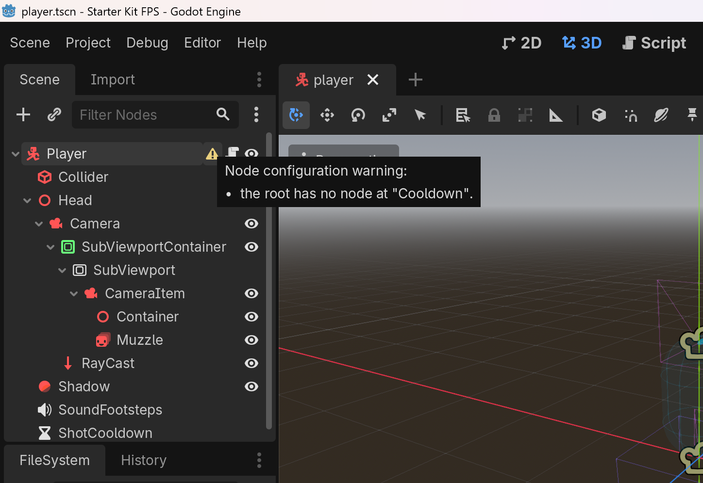

# Petrichor

Petrichor 是一门面向 Godot 4 的静态类型脚本语言，沿用 GDScript 的写法。与 GDScript 写法相同的代码，要么行为一致，要么在编译期报错并给出改法。它以 GDExtension 交付，装进官方编辑器即可使用。导出用官方模板，不需要自己编译引擎。

项目处于 0.1 发布前的开发阶段。1.0 之前语义仍可能调整，详见[状态与限制](#状态与限制)。

English: [README.md](README.md)



## 为什么

Godot 项目变大以后，重构越来越依赖运行时才暴露的错误。GDScript 的类型是渐进的。即使脚本写满类型，场景中的节点路径、信号连接和导出属性仍是动态的。对象引用默认可为空，运行时出错后调用方仍会拿到假值继续执行。C# 有静态类型，但桥接层有不少暗坑（[调查](docs/surveys/pitfalls.md)）。

Petrichor 把静态检查延伸到场景，并让空值和失败在编译期可见。

## 和 GDScript 的区别

下面的 GDScript 能通过检查，却会在运行时出错：场景里的 `Camera` 改了名，或者 `target` 是 null。

```gdscript
@onready var camera: Camera3D = $Head/Camera
var target: Node3D

func aim():
    camera.look_at(target.global_position)
```

在 Petrichor 中，`camera` 的类型由挂载脚本的场景推出，节点改名时编译期就报错。`target` 写成 `Node3D?`，读取前要先检查：

```gdscript
@onready var camera = $Head/Camera
var target: Node3D?

func aim():
    camera.look_at(target.global_position)
    # 编译错误：The value may be None (Node3D?); check it before reading "global_position".
```

```gdscript
func aim():
    var t := target
    if t != None:
        camera.look_at(t.global_position)
```

其余的区别：

- 信号连接和导出属性也按场景检查，错误标在场景节点上。
- 对象类型默认非空。已释放的对象在 `T?` 上读作 `None`。
- 预期内的失败用 `Option` 和 `Result[T, E]` 表示，后缀 `?` 提前返回。
- 有值语义的 `struct`、带载荷的 `enum`、穷尽的 `match`、接口和任意嵌套的带类型容器。
- `async func` 返回有归属的 `Task`。所属对象被释放时，协程随之取消，不会永远挂起。
- 可以与 GDScript 插件和 C# 代码混用。
- 编辑器提供补全、悬停类型、跳转、格式化、断点和函数体热重载。

完整规则见[语言规范](docs/language-spec.zh.md)。

在微基准上，纯计算比 GDScript 快 1.2 到 3.5 倍，读写引擎属性快约 1.6 倍。调用引擎方法、发信号和创建对象时，时间主要花在引擎里，两者相近。项目启动时间持平（[基准](docs/architecture.md#4-性能)）。

两个真实项目迁移后的脚本已能运行：Kenney 的 FPS 起步工程和 Ring 中的打砖块小游戏（[迁移调查](docs/surveys/paper-migration-2.md)）。

## 试用

0.1 发布时，GitHub Releases 页面提供两个包：

- 演示包：FPS 起步工程加迁移后的脚本，用 Godot 4.7 打开即可运行。
- 插件包：解压到自己的项目中，重启编辑器后就能新建 `.pet` 脚本。

在 CI 中检查整个项目：

```sh
godot --headless -e --path <project> -- --petrichor-build
godot --headless -e --path <project> -- --petrichor-format --check
```

在那之前可以从源码构建，需要 C++17 工具链和 SCons。先运行 `git submodule update --init`，再运行 `scons`。

## 状态与限制

0.1 是首次公开发布，目的是在 1.0 之前收集真实项目对语义的反馈。

- 适合：已大量使用带类型 GDScript、愿意随 0.x 调整代码的项目。
- 暂不适合：要导出到 Android、iOS 或 Web 的项目。这些平台的库随 0.9 提供。
- 0.9 之前，语言语义可能调整，不兼容的改动都在发布说明中列出。0.9 起，改变代码含义的改动都以编译错误出现。只改运行时行为的修正，在发布说明中单独列出。
- 字节码不跨构建兼容。升级扩展后，项目要重新构建一次。
- 编辑器还没有查找引用、重命名、快速修复、lint 和 LSP。它们排在 0.2–0.3。
- 还没有 GDScript 迁移工具，0.1 要手工迁移。工具排在 0.2–0.3。
- 支持 Godot 4.7 及之后的版本。

完整路线见[实现架构](docs/architecture.md#5-推进顺序)，未完成的工作见 [BACKLOG.md](BACKLOG.md)。

## 开发方式

Petrichor 的语言设计和每条规范由作者决定。实现、测试、文档和语料调查主要由 AI 编码代理完成。作者不逐行审阅代码。代理遵循仓库中的 [AGENTS.md](AGENTS.md)。正确性靠下面几点保证：

- 规范是唯一的规则来源。实现与规范不符时，改的是实现。
- 测试从规范和引擎行为推出，不从实现推出。
- 引擎行为逐条对照 Godot 源码，并记下提交和行号。
- 两个真实项目迁移后的脚本在引擎中运行。

出了问题由作者负责修复。0.1 期间只接受 issue，不接受 PR。开发进展很快，PR 等到审阅时多半已经过时。缺陷请提 issue，对语言规则的意见请发到 Discussions，都会在 48 小时内回复。接近 1.0 时再开放 PR。

## 文档

- [语言规范](docs/language-spec.zh.md)
- [实现架构](docs/architecture.md)
- [设计说明](docs/design-notes.md)：规则背后的取舍、语料计数和被否决的方案
- [引擎事实](docs/engine-facts.md)：依赖的引擎行为及其源码出处
- [开发说明](docs/development.md)：构建、测试和调试中的坑
- [语料调查](docs/surveys/README.md)：基于 20 个 Godot 4 项目，每份附复现脚本

`docs/` 下的文档目前为中文。英文版语言规范随 0.1 提供。

## 许可证

[MIT](LICENSE)
